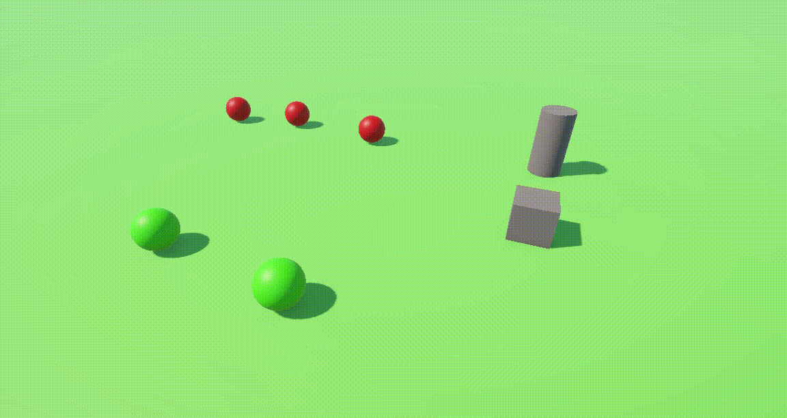
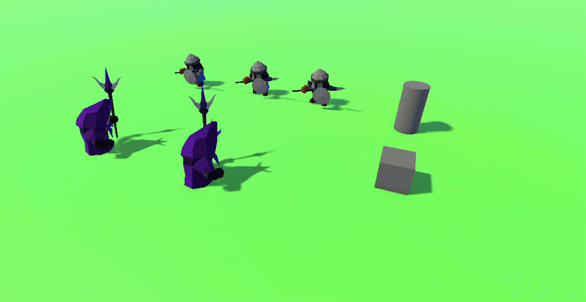
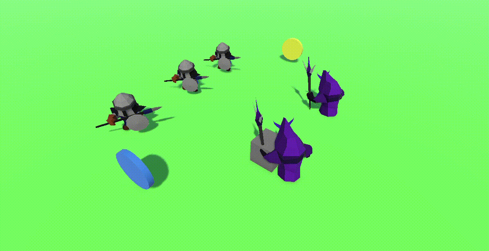
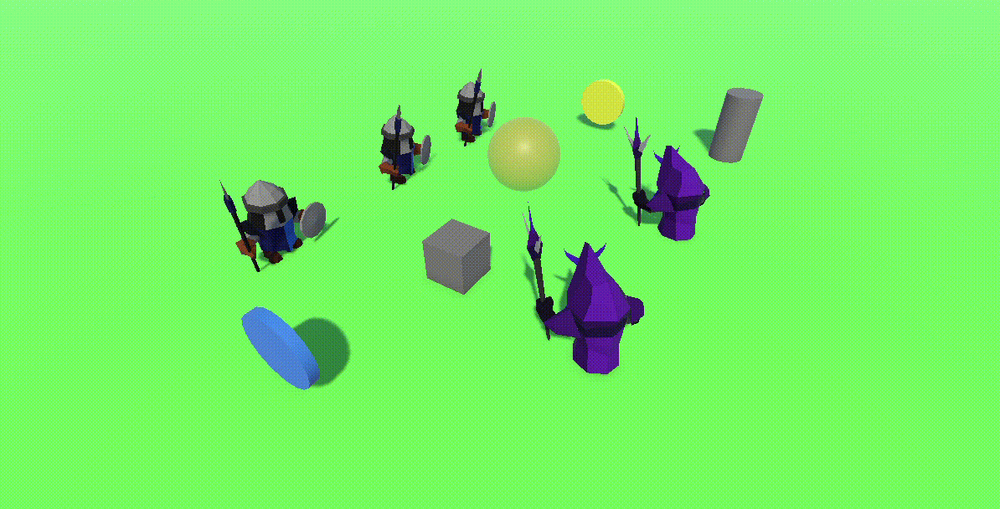
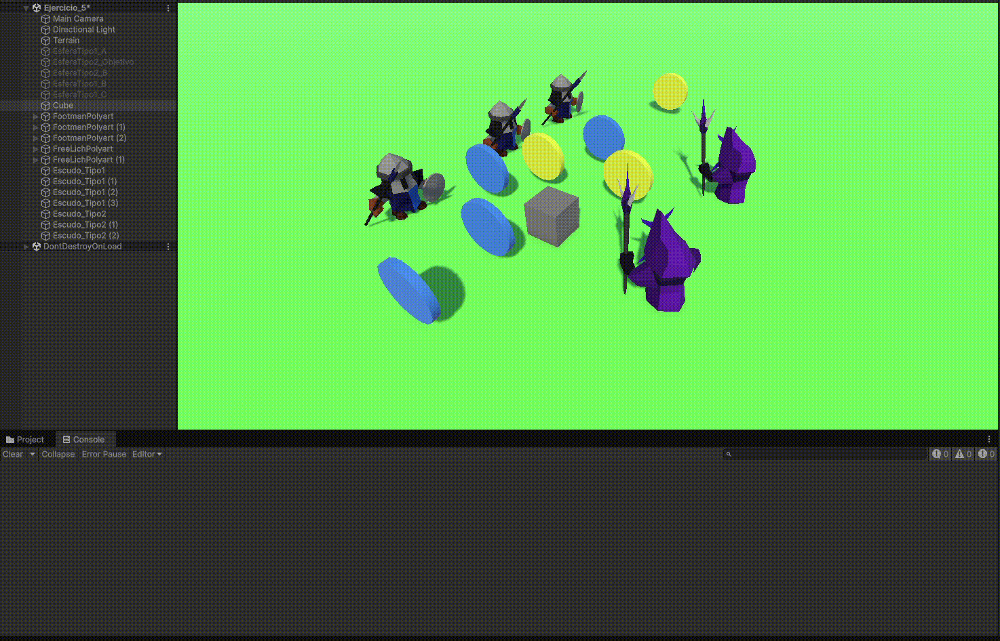
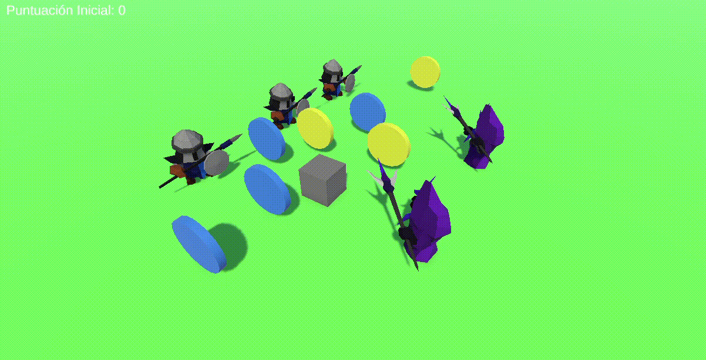
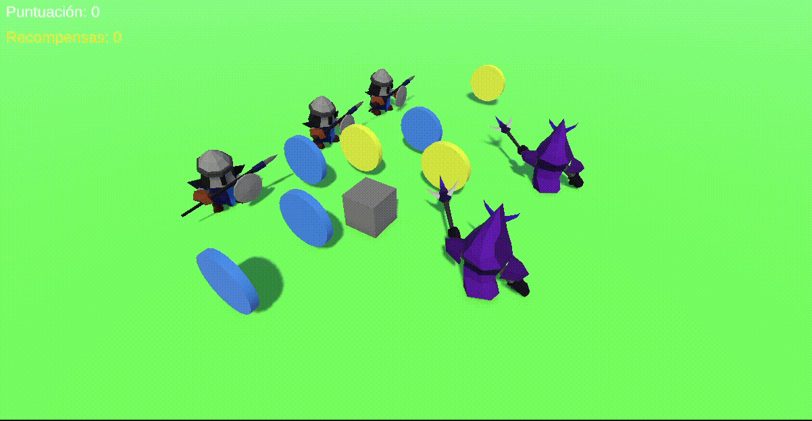
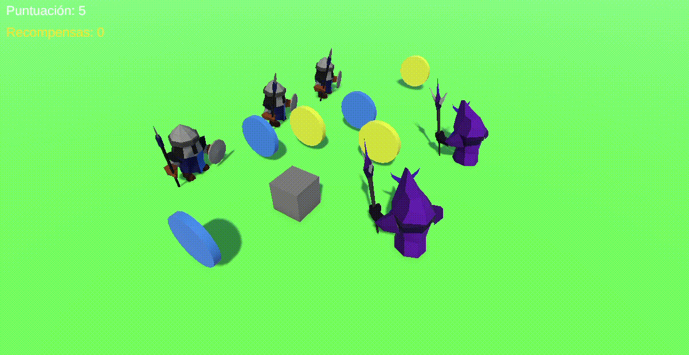
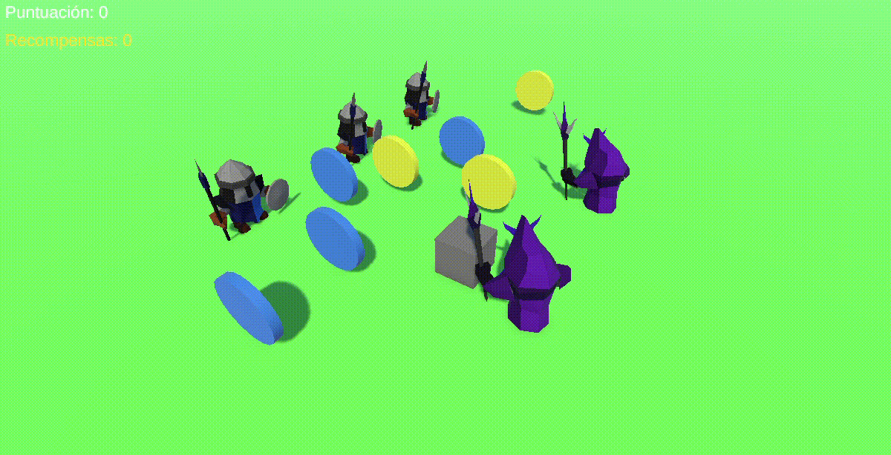

# Práctica 4 — Delegados y Eventos (Unity)

Proyecto de Unity con la **Práctica 4: Delegados y Eventos**, compuesta por nueve ejercicios
encadenados en los que se aplica el patrón **Notificador / Observador** para que distintos
objetos de una escena se comuniquen entre sí **sin conocerse directamente**.

| | |
|---|---|
| **Motor** | Unity `6000.5.11f1` |
| **Pipeline** | Universal RP `17.5.0` |
| **Input** | Input Manager clásico (`activeInputHandler: 0`) |
| **Escenas** | `Assets/Scenes/Ejercicio_1.unity` … `Ejercicio_9.unity` |
| **Scripts** | `Assets/Scripts/` (13 scripts) |
| **Material** | `media/` (un GIF por ejercicio) |

---

## Índice

1. [Ejercicio 1 — Esferas, cubo y cilindro](#ejercicio-1--esferas-cubo-y-cilindro)
2. [Ejercicio 2 — De geometrías a humanoides](#ejercicio-2--de-geometrías-a-humanoides)
3. [Ejercicio 3 — Humanoides, escudos y cambio de color](#ejercicio-3--humanoides-escudos-y-cambio-de-color)
4. [Ejercicio 4 — Teletransporte y orientación por proximidad](#ejercicio-4--teletransporte-y-orientación-por-proximidad)
5. [Ejercicio 5 — Recolección de escudos y puntuación](#ejercicio-5--recolección-de-escudos-y-puntuación)
6. [Ejercicio 6 — Interfaz de usuario con la puntuación](#ejercicio-6--interfaz-de-usuario-con-la-puntuación)
7. [Ejercicio 7 — Recompensas cada 100 puntos](#ejercicio-7--recompensas-cada-100-puntos)
8. [Ejercicio 8 — Escena de prototipo](#ejercicio-8--escena-de-prototipo)
9. [Ejercicio 9 — El cubo como objeto físico](#ejercicio-9--el-cubo-como-objeto-físico)
10. [Conclusiones generales](#conclusiones-generales)
11. [Mapa de scripts](#mapa-de-scripts)
12. [Mapa de escenas](#mapa-de-escenas)

---

## Ejercicio 1 — Esferas, cubo y cilindro

**Enunciado.** Escena con 5 esferas rojas (tipo 1) y verdes (tipo 2), un cubo y un cilindro.
Cuando el cubo colisiona con el cilindro, las esferas de tipo 1 van hacia una esfera de tipo 2
fijada de antemano y las de tipo 2 se desplazan hacia el cilindro.

**Qué se implementó.**

| Elemento | Script | Rol |
|---|---|---|
| `Cylinder` | `CilindroNotificador.cs` | Emisor. Publica `static event NotificacionColision OnCuboChoca` desde `OnCollisionEnter`. |
| `EsferaTipo1_A/B/C` | `ObservadorTipo1.cs` | Observador tipo 1. Se acerca a `objetivoEsferaTipo2` y lo mira. |
| `EsferaTipo2_B` | `ObservadorTipo2.cs` | Observador tipo 2. Se acerca a `objetivoCilindro` y lo mira. |
| `Cube` | `ImpulsarCubo.cs` | Dispara el cubo hacia el cilindro con `AddForce` (barra espaciadora). |

**Conclusiones.**

- El enunciado se resuelve con un **delegado** (`public delegate void NotificacionColision;`) y un
  **evento** (`public static event NotificacionColision OnCuboChoca;`). El cilindro **emite**, las
  esferas **escuchan**: el emisor no sabe siquiera cuántos observadores hay.
- La suscripción se hace en `OnEnable()` y la baja en `OnDisable()`. Es la forma correcta de
  gestionarlo: si se suscribiera en `Start()` sin desuscribirse, cada vez que se destruyera y
  recreara el objeto habría suscripciones fantasma.
- ⚠️ **Trampa detectada:** en `CilindroNotificador` el `if` que comprueba el nombre del objeto solo
  protege al `Debug.Log`; el evento se lanza ante **cualquier** colisión. Para filtrar de verdad hay
  que meter la comprobación *dentro* del `if` que invoca al evento.
- Los observadores se mueven con `Vector3.MoveTowards` (movimiento con tope, no se pasa del objetivo)
  y se reorientan con `LookAt` construyendo un punto de mira a la **misma altura** (`y = transform.position.y`),
  porque si no el objeto se inclina al mirar a un punto a distinta elevación.



---

## Ejercicio 2 — De geometrías a humanoides

**Enunciado.** Sustituir los objetos geométricos por humanoides y repetir la mecánica anterior.

**Qué se implementó.** Se sustituyeron las esferas por instancias de los prefabs
`FootmanPolyart.prefab` y `FreeLichPolyart.prefab`, manteniendo **exactamente los mismos scripts**
(`ObservadorTipo1`, `ObservadorTipo2`, `CilindroNotificador`, `ImpulsarCubo`).

**Conclusiones.**

- **La lógica vive en el script, no en el objeto.** Cambiar la malla, el rig, el animator o el
  prefab entero no afecta a la mecánica: por eso sustituir las esferas por humanoides fue un
  "copiar, pegar y renombrar" sin tocar una línea de código.
- Se usaron **prefabs** para instanciar varios humanoides idénticos manteniendo sus características
  (y para poder ajustar los campos públicos desde el Inspector en cada instancia).
- `ImpulsarCubo` usa `AddForce(direccion * force, ForceMode.Impulse)`: un **impulso** único que
  deja al cubo en movimiento por inercia, muy distinto de moverlo con `transform.Translate`.



---

## Ejercicio 3 — Humanoides, escudos y cambio de color

**Enunciado.** Humanoides de tipo 1 y de tipo 2 y escudos de tipo 1 y tipo 2 (objetos físicos).
Si el cubo choca con un humanoide tipo 2, los del grupo 1 se acercan a un escudo seleccionado; si
choca con un humanoide del grupo 1, se dirigen a los escudos del grupo 2. Si un humanoide colisiona
con un escudo, debe cambiar de color.

**Qué se implementó.**

| Elemento | Script | Rol |
|---|---|---|
| `Lich` (tipo 2) | `LichDetector.cs` | Al colisionar con el cubo llama a `NotificadorEventos.NotificarChoqueLich()`. |
| `Footman` (grupo 1) | `FootmanComportamiento.cs` | Se suscribe a los dos eventos y cambia de objetivo; además cambia de color al tocar un `Escudo_Tipo2`. |
| Bus de eventos | `NotificadorEventos.cs` | Traduce la colisión en `OnCuboChocaConLich` / `OnCuboChocaConFootman`. |
| `Escudo_Tipo1` / `Escudo_Tipo2` | — | Objetos físicos con **tags** propias. |

**Conclusiones.**

- Aquí aparece el **doble nivel de indirección**: el `Lich` no llama al `Footman` directamente, sino
  que publica un evento global (`NotificadorEventos`) y el `Footman` decide a qué escudo ir según
  cuál sea el evento recibido. Así el grupo 1 **no necesita saber qué tipo de humanoide** ha tocado:
  solo reacciona a "han chocado contigo" / "ha chocado un lich".
- La **comparación por tag** (`collision.gameObject.CompareTag("Escudo_Tipo2")`) es mucho más
  robusta que comparar `name` (que el propio enunciado sugiere): no falla por mayúsculas, acentos o
  espacios, y el tag se valida en el Inspector.
- El cambio de color se hace sobre `rend.material.color = Color.yellow`. ⚠️ Ojo: la propiedad
  `.material` **crea una copia instanciada** del material en ese GameObject (y duplica la memoria).
  Si lo que se quiere es modificar el material compartido, hay que usar `sharedMaterial` o un
  `MaterialPropertyBlock`. Aquí interesa precisamente lo contrario: que solo cambie el humanoide
  que ha colisionado y no todos los que comparten prefab.
- El movimiento ahora se hace con la API física (`rb.MovePosition` y `rb.MoveRotation` con
  `Quaternion.LookRotation`) dentro de `FixedUpdate()`, en lugar de `transform.Translate` en
  `Update()`: así el humanoide de verdad empuja, choca y es empujado.



---

## Ejercicio 4 — Teletransporte y orientación por proximidad

**Enunciado.** Cuando el cubo se aproxima al objeto de referencia, los humanoides del grupo 1 se
teletransportan a un escudo objetivo fijado de antemano; los del grupo 2 se orientan hacia un
objeto situado en la escena con ese propósito.

**Qué se implementó.**

| Elemento | Script | Rol |
|---|---|---|
| `Sphere` (objeto de referencia) | `ReferenciaNotificador.cs` | `OnTriggerEnter` → publica `static event AccionProximidad OnCuboAproximado` (una sola vez). |
| `Footman` (grupo 1) | `FootManTeleport.cs` | Se teletransporta a `escudoObjetivo` (`transform.position = ...`). |
| `Lich` (grupo 2) | `LichOrientacion.cs` | `transform.LookAt(objetoEncarar)`. |

**Conclusiones.**

- Para "acercarse" no se usa `OnCollisionEnter` sino **`OnTriggerEnter`**: el *trigger* detecta la
  proximidad sin necesidad de que haya contacto real. Requiere que al menos uno de los dos
  cuerpos tenga `Rigidbody`.
- `ReferenciaNotificador` incluye el flag `yaNotificado` porque **`OnTriggerEnter` puede dispararse
  varias veces** (varios colliders en el mismo objeto, o colisiones sucesivas). Con ese guardia la
  notificación se emite una única vez, que es justo la semántica de "el cubo se ha acercado".
- El teletransporte se implementa asignando directamente `transform.position`; la orientación usa
  `LookAt` sobre un punto con la **misma altura** que el propio lich, para que gire sobre su eje
  vertical en lugar de tumbarse.
- Las referencias (`escudoObjetivo`, `objetoEncarar`, `objetivoEsferaTipo2`…) son `Transform`
  públicos que se **inyectan desde el Inspector**: es lo que permite que el mismo script sirva para
  cualquier objeto de la escena sin hardcodear posiciones.



---

## Ejercicio 5 — Recolección de escudos y puntuación

**Enunciado.** Implementar la mecánica de recolectar escudos en la escena, actualizando la
puntuación del jugador. Los escudos de tipo 1 suman 5 puntos y los de tipo 2 suman 10.
Mostrar la puntuación en la consola.

**Qué se implementó.** `RecolectarEscudos.cs` (en el cubo) comprueba el tag del objeto colisionado,
suma los puntos, muestra el valor por consola y **destruye el escudo** (`Destroy`) para consumirlo.

**Conclusiones.**

- La puntuación se encapsuló en un método `SumarPuntos(int puntos)` que centraliza el `Debug.Log`.
  Ese refactor es el que permite que en el ejercicio 6 la misma puntuación se muestre en la UI
  **sin duplicar ni una línea** de la lógica de juego.
- `Destroy(collision.gameObject)` consume el escudo: el objeto desaparece de la escena y no se puede
  puntuar dos veces. (Ojo: `Destroy` es diferido hasta el final del frame, así que dentro del mismo
  frame una segunda colisión con el mismo escudo volvería a sumar puntos.)
- La lógica se apoya en **tags** y no en el nombre del objeto, y como la puntuación vive en un
  componente del cubo, se puede añadir cualquier otro sistema (UI, sonido, partículas) sin tocarlo.
- En esta primera versión el escudo de tipo 2 valía **10 puntos**, tal y como pide el enunciado
  (véase la sección del ejercicio 7 para el ajuste posterior).



---

## Ejercicio 6 — Interfaz de usuario con la puntuación

**Enunciado.** Crear una interfaz que muestre la puntuación que va obteniendo el cubo.

**Qué se implementó.** `Canvas` + dos `TextMeshProUGUI` (`TextoPuntuación` y `TextoRecompensa`) y el
script `ControladorUIPuntuacion.cs`, que se suscribe a los eventos estáticos de `RecolectarEscudos`
y actualiza el texto.

```csharp
private void OnEnable() {
    RecolectarEscudos.OnPuntuacionCambio += ActualizarTexto;
    RecolectarEscudos.OnRecompensaObtenida += ActualizarTextoRecompensa;
}

private void OnDisable() {
    RecolectarEscudos.OnPuntuacionCambio -= ActualizarTexto;
    RecolectarEscudos.OnRecompensaObtenida -= ActualizarTextoRecompensa;
}
```

**Conclusiones.**

- El HUD **no consulta** la puntuación: **se suscribe al evento** y reacciona. La puntuación puede
  viven en el cubo, en un singleton o en un sistema de guardado; el HUD no lo sabe ni le importa.
- Suscribir en `OnEnable()` y desuscribir en `OnDisable()` es **imprescindible** cuando el evento es
  `static`: sin la baja, cada vez que se recargue la escena se acumularía una suscripción más
  (fuga de memoria) y el HUD recibiría eventos de escenas anteriores.
- El texto se compone con interpolación (`$"Puntuación: {nuevaPuntuacion}"`) y el valor inicial
  (`Puntuación: 0`) es simplemente el texto por defecto del componente `TextMeshProUGUI`.
- El `CanvasScaler` con resolución de referencia **1920×1080** hace que la interfaz se escale
  correctamente en cualquier resolución de pantalla.
- Alternativa que no se ha usado: `UnityEvent` serializable en el Inspector. Es más fácil de
  configurar sin escribir código, pero ata la configuración a la escena y no admite la lógica
  (parámetros, `if`, bucles) que sí permite un `delegate`.



---

## Ejercicio 7 — Recompensas cada 100 puntos

**Enunciado.** Implementar una mecánica en la que cada 100 puntos el jugador obtenga una recompensa
que se muestre en la UI.

**Qué se implementó.** Segundo evento en `RecolectarEscudos`:

```csharp
public delegate void AccionRecompensa(int numeroRecompensa);
public static event AccionRecompensa OnRecompensaObtenida;
```

con un umbral (`umbralRecompensa`) que se va desplazando y un contador `recompensas`.

**Conclusiones.**

- Un **segundo evento** para un segundo tipo de información. `OnPuntuacionCambio` sigue emitiendo el
  marcador y `OnRecompensaObtenida` las recompensas: cada consumidor se suscribe solo a lo que le
  interesa, sin tener que comprobar si el valor cumple una condición ajena a su propósito.
- El umbral se comprueba con un **`while` y no con un `if`**. Con `if`, un solo escudo que dé 100+
  puntos solo otorgaría *una* recompensa y se perderían las demás; el `while` concede tantas
  recompensas como haga falta y deja el umbral correctamente despegado.
- ⚠️ **Ajuste respecto al enunciado:** el escudo de tipo 2 pasó de **10 a 100 puntos**. Con 10 puntos
  por escudo el umbral de 100 exigía 10 escudos de tipo 2, lo que hacía la recompensa casi
  inalcanzable en una escena de prueba. En el GIF se ve el resultado: `Puntuación: 110` →
  `Recompensas: 1`.
- El texto de recompensas se escribe en **amarillo**, diferenciándolo visualmente del marcador.



---

## Ejercicio 8 — Escena de prototipo

**Enunciado.** Generar una escena que incluya elementos que se ajusten a la escena del prototipo y
alguna de las mecánicas anteriores.

**Qué se implementó.** Una escena que integra **todo** lo anterior: humanoides (footmen y lichs),
escudos de tipo 1 y 2 con tags, esferas de referencia, cubo con control físico, `Canvas` con el
marcador de puntuación y el de recompensas, y todas las mecánicas de reacción a colisiones.

**Conclusiones.**

- El patrón **evento/observador escala**: seis sistemas independientes (colisiones del cubo, del
  cilindro, proximidad, escudos, puntuación, recompensas) se comunican sin que ninguno tenga
  referencia directa a los demás. Cada uno publica *qué ha pasado* y quien quiera, escucha.
- La escena es el lugar donde se comprueba si la arquitectura aguanta: si añadir la UI de
  recompensas (ejercicio 7) o el teletransporte (ejercicio 4) no ha tenido que tocar el código de
  las mecánicas anteriores, el diseño está bien desacoplado.
- Las mecánicas se pueden **activar y desactivar por objeto** (las esferas de tipo 1 están
  desactivadas en las escenas finales) sin romper nada, porque la comunicación no depende de que
  ambos extremos estén presentes: el `if (evento != null)` de la invocación lo protege.



---

## Ejercicio 9 — El cubo como objeto físico

**Enunciado.** Implementar el ejercicio 3 siendo el cubo un objeto físico.

**Qué se implementó.** `ControlarCubo.cs` pasó de mover el `transform` a mover un `Rigidbody`:

```csharp
// Antes (no físico)
transform.Translate(direccion * speed * Time.deltaTime);

// Ahora (físico)
void Update() {                       // se lee el input: una vez por frame
    direccionInput = new Vector3(horizontal, 0, vertical).normalized;
}

void FixedUpdate() {                 // se aplica el movimiento: a ritmo de física
    if (direccionInput != Vector3.zero) {
        rb.MovePosition(rb.position + direccionInput * speed * Time.fixedDeltaTime);
    }
}
```

**Conclusiones.**

- La diferencia clave es **dónde** y **cuándo** se aplica el movimiento:
  - `transform.Translate` en `Update()` → depende del framerate, ignora la física y no empuja a los
    demás cuerpos.
  - `Rigidbody.MovePosition` en `FixedUpdate()` → el cubo pasa a ser un cuerpo físico real: choca,
    empuja a los humanoides, es frenado por la gravedad y el motor lo interpola correctamente.
- **Separar input y movimiento** es el patrón correcto: `Update()` solo lee el teclado (una vez por
  frame, lo más barato posible) y `FixedUpdate()` aplica el movimiento a ritmo fijo de física
  (`Time.fixedDeltaTime`). Si se moviera en `Update`, la velocidad dependería de los FPS.
- `MovePosition` en lugar de `AddForce` da **control directo de la velocidad** sin aceleración:
  útil para un control de jugador, mientras que `AddForce` (como en `ImpulsarCubo`, ejercicio 2)
  da un comportamiento más "físico" con inercia.
- Normalizar la dirección (`Vector3.normalized`) evita que el cubo se mueva más rápido en diagonal
  (el vector sin normalizar mide `√2` en las diagonales).



